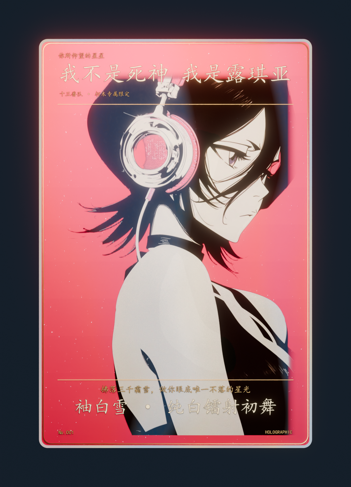

# ❄️ 3D Interactive Holographic Laser Card: Kuchiki Rukia (朽木露琪亚专属3D全息镭射闪卡)

A stunning, single-file interactive 3D holographic foil card dedicated to **Kuchiki Rukia (朽木·露琪亚)** from *Bleach (死神)*.

> **Crafted with love & romance by 阿宁 (sukikeeling). Dedicated as a cherished token.**

---

## 📸 Preview (效果预览)

---

## ✨ Features (核心亮点)

- **Interactive 3D Gyro / Mouse Parallax (3D 陀螺仪与鼠标视差拟真)**:
  - Real-time `perspective: 1200px` 3D card tilt tracking mouse cursor position (or mobile gyroscope tilt).
  - Smooth spring physics and momentum dampening.
- **Holographic Rainbow Foil & Sheen Shader (动态彩虹全息反光折射)**:
  - Multi-layer CSS linear and radial specular gradients reacting dynamically to light angle.
  - Sparkle dust particles and high-frequency glare reflections.
- **Pure Single-File Architecture (纯单文件绿色无依赖)**:
  - Complete zero external dependencies — HTML, CSS, JavaScript, textures, and vector assets all bundled in a single self-contained document.
- **Double-Click to Enjoy (开箱即用)**:
  - Runs perfectly offline directly from disk in any modern web browser.

---

## 🚀 Live Demo & Usage (使用指南)

Double-click `index.html` in any browser to open. Move your mouse or drag to inspect the holographic reflection and depth effects from all angles.

---

## 📜 License

MIT License.
